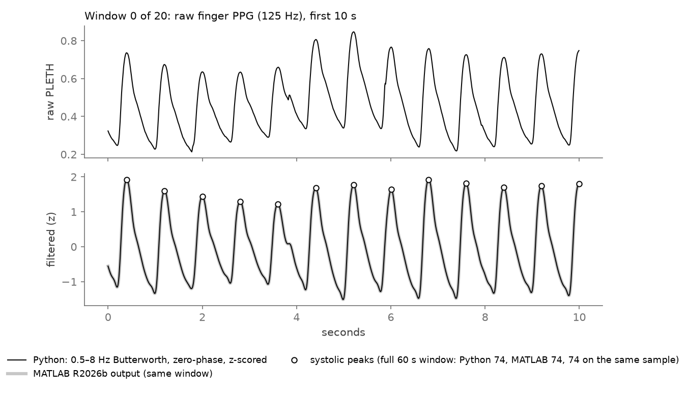
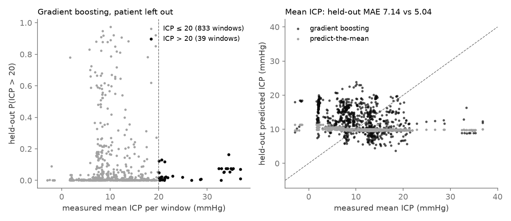
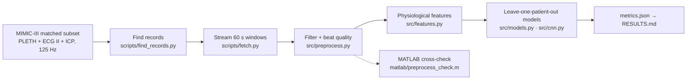

<div align="center">

# Non-Invasive ICP Estimation from Finger PPG

**Can a finger pulse signal tell the brain pressure of an ICU patient the model has never seen?**

An end-to-end test on open ICU data: finger PPG and ECG from the MIMIC-III Waveform Database, invasive intracranial
pressure (ICP) as ground truth, physiology-based features, and every model scored only on held-out patients.

[**Project page →**](https://dheepakkaran.github.io/ppg-icp-estimation/) · [Results](RESULTS.md) · [Data card](DATA_QUALITY.md) · [Features](FEATURES.md) · [Literature](LITERATURE.md)


-737373)


<a href="https://dheepakkaran.github.io/ppg-icp-estimation/#overview"></a>

<sub>35-second overview (silent preview). <a href="https://dheepakkaran.github.io/ppg-icp-estimation/#overview">Watch it with sound on the project page →</a></sub>

</div>

> **Research prototype.** Open, de-identified ICU data. Not a medical device, no clinical claim. Independent project.

---

## Why this exists

ICP is measured today with a sensor placed through the skull, so it is reserved for the sickest patients. A finger
pulse sensor (photoplethysmography, PPG) is on almost every ICU patient already. If its waveform carried enough
information about ICP, a cheap, non-invasive warning for raised ICP would be possible.

The hard part is honesty. ICP level differs mostly **between** patients, so a model that sees a patient in training
can look good just by learning who the patient is. This repo asks the strict version: leave one patient out, predict
that patient's ICP from PPG alone, and report training numbers next to held-out numbers.

## Results

10 ICU patients · 872 one-minute windows (14.5 h) · leave-one-patient-out · 95% CI bootstrapped over patients
(`results/metrics.json` → [RESULTS.md](RESULTS.md)).

| Model | ICP > 20 mmHg: held-out AUROC | Training AUROC | Mean ICP: held-out MAE (mmHg) |
|---|---|---|---|
| Predict-the-mean baseline | 0.14 [0.04, 0.30] | 0.50 | **5.04** [3.70, 6.65] |
| Ridge / logistic regression | 0.65 [0.39, 0.89] | 0.86 | 6.68 [4.86, 9.30] |
| Gradient boosting | **0.72** [0.52, 0.89] | 1.00 | 7.14 [5.08, 10.02] |
| 1D CNN on raw PPG | 0.39 [0.13, 0.66] | 0.91 | 5.95 [3.96, 8.47] |

- **Raised-ICP detection carries some signal.** Gradient boosting reaches 0.72 AUROC on unseen patients, but the interval is wide: only 39 windows are above 20 mmHg, from 6 patients.
- **No model beats the mean on the pressure value.** Training scores are far better than held-out scores (AUROC 1.00 vs 0.72), so the fit is patient-specific.
- **Pulse transit time is not predictive here.** Pooled Spearman ρ with ICP is 0.01; the median within-patient ρ is −0.08 (negative in 6 of 9). Physiology predicts a negative link, so the evidence is weak at best.
- **MATLAB check.** The filter and peak detector were re-written in MATLAB and run in MATLAB R2026b: filtered signal within 1.97e-06 of Python, **2,090 of 2,090** peaks on the same sample ([`results/matlab_online_check.json`](results/matlab_online_check.json)). GNU Octave 10.3.0 gives 7.97e-07 and the same 2,090 peaks.

### Demo: one real window, and every held-out prediction



*The first 10 s of one of the 20 committed MIMIC-III PPG windows (`results/matlab_windows.csv`): raw signal on top;
below, the Python filter (black) over the MATLAB R2026b output (grey) with the detected systolic peaks.
Drawn by `scripts/make_demo_figures.py`.*



*All 872 out-of-patient predictions from `results/oof_predictions.csv`. Left: windows above 20 mmHg rank somewhat
higher (AUROC 0.72), but their predicted probabilities stay low. Right: predict-the-mean stays near 10 mmHg; gradient
boosting spreads its predictions without following measured ICP, so its error is larger.*

## How it works



1. **Record search.** Scan layout headers of the matched subset for records with `PLETH`, `II` and `ICP` together (8,334 of 22,317 records scanned; 25 subjects found, 12 with at least 10 windows where all three overlap).
2. **Fetch.** Byte-range reads from PhysioNet, at most 2 h per subject, cut into 60 s windows. No login needed.
3. **Signal processing.** Zero-phase Butterworth band-pass (PPG 0.5–8 Hz, ECG 5–30 Hz), z-score, ECG R-peaks, PPG feet and peaks, beat template correlation ≥ 0.9. Flat, missing, clipped or noisy windows are rejected: 882 of 1,277 kept.
4. **Features.** Pulse transit time, pulse amplitude, rise time, width at 50%, heart rate, beat-to-beat variability, FFT harmonic ratios; each with a physiological reason in [FEATURES.md](FEATURES.md).
5. **Models.** Predict-the-mean, ridge / logistic, gradient boosting, 1D CNN on raw PPG; targets = mean ICP per window and ICP > 20 mmHg (> 22 mmHg as a sensitivity check).

## Design decisions

| Decision | Why |
|---|---|
| **Leave-one-patient-out, enforced by an assert and a test** | ICP level is mostly a patient trait; any patient overlap between train and test inflates the score |
| **Training numbers printed next to held-out numbers** | the gap (1.00 vs 0.72 AUROC) is the clearest sign of patient-specific fit |
| **Predict-the-mean baseline in every table** | it is the bar a model must clear; here it wins on MAE |
| **CI bootstrapped over patients, not windows** | windows from one patient are not independent; window-level CIs would be far too narrow |
| **Hand-made physiological features before deep learning** | with 10 patients, features with a known mechanism are easier to check than a CNN, which did worse (0.39) |
| **MATLAB pad length in SciPy `filtfilt`** | SciPy pads 3·nfilt, MATLAB 3·(nfilt−1); matching it cut the edge difference from 0.27 to ~1e-06 |
| **Independent MATLAB re-implementation** | a second implementation catches filter and peak-detector bugs that unit tests on synthetic pulses miss |

## What broke / what the data showed

1. **ICP is rarely recorded for long next to PPG and ECG.** Many candidate subjects had 0–3 usable windows; 12 had enough overlap and 10 kept ≥ 10 windows after quality checks ([DATA_QUALITY.md](DATA_QUALITY.md)).
2. **ICP stuck at exactly 37.0 mmHg.** Two subjects show long flat stretches (SD 0), a placeholder value, not physiology. The `icp_flat` rule removes them (244 windows rejected as flat ICP).
3. **Python and MATLAB disagreed at the window edges** (0.27 z-units) until the `filtfilt` pad length was matched.
4. **Octave's `findpeaks` has no `MinPeakProminence`.** `matlab/find_peaks_scipy.m` re-writes SciPy's `find_peaks(distance, prominence)` rule in plain MATLAB.
5. **Gradient boosting crawled on a shared machine** with many OpenMP threads; the Makefile sets `OMP_NUM_THREADS=1`.
6. **The baseline's AUROC is below 0.5 by construction.** Leaving out a high-ICP patient lowers the predicted rate for exactly that patient ([RESULTS.md](RESULTS.md)).

## Run it

```bash
git clone https://github.com/dheepakkaran/ppg-icp-estimation.git
cd ppg-icp-estimation
make reproduce   # uv env → fetch from PhysioNet → features → tests → models → Octave check → RESULTS.md
make test        # 4 pytest checks: filters, beat detection, no patient in both train and test
uv run --with matplotlib python scripts/make_demo_figures.py   # redraw docs/assets/ from results/
```

- **Needs:** [uv](https://docs.astral.sh/uv/), internet (PhysioNet, no login), ~100 MB disk, < 1 GB RAM.
- **Optional:** [pixi](https://pixi.sh) for the MATLAB-syntax check under GNU Octave (skipped if missing).
- **Record search:** `results/candidates.csv` is committed, so `make find` (a slow header scan) is optional.
- **MATLAB:** from the repo root, `addpath matlab; preprocess_check`, then `python scripts/compare_matlab.py`.

## Repo map

| Path | What |
|---|---|
| `src/preprocess.py` · `features.py` | filters, beat detection, beat quality, window rejection · per-window features |
| `src/models.py` · `cnn.py` | leave-one-patient-out models with patient bootstrap · 1D CNN on raw PPG |
| `scripts/` | `find_records` · `fetch` · `build_features` · `run_models` · `make_results` · `compare_matlab` · `make_demo_figures` |
| `matlab/` | `preprocess_check.m` · `find_peaks_scipy.m` (MATLAB / Octave), pixi env for Octave |
| `tests/test_pipeline.py` | synthetic-pulse filter and beat tests, patient-split check |
| `results/` | `metrics.json`, `features.csv`, out-of-patient predictions, MATLAB/Octave check files, logs |
| `RESULTS.md` · `DATA_QUALITY.md` | all numbers · data card (generated from `results/`) |
| `FEATURES.md` · `LITERATURE.md` | every feature with its physiological reason · 5 papers and what this repo adds |
| `docs/index.html` | the project page (GitHub Pages) |

## Limits

- **Small cohort.** n = 10 patients and 39 hypertensive windows; confidence intervals are wide and one patient can swing a pooled metric.
- **Indirect signal.** Finger PPG reflects the systemic circulation, not the brain. Forehead near-infrared PPG, used by several non-invasive ICP devices, is not in this data.
- **Not exhaustive.** Only 8,334 of 22,317 matched records were scanned.
- **Pooled AUROC** also rewards ranking patients against each other, not only tracking ICP within one patient.

## Next

Scan the rest of the matched subset for more patients · dicrotic-notch and augmentation features · models of
within-patient ICP change rather than level · SHAP / partial dependence on the gradient boosting model.

## Data and citation

- **MIMIC-III Waveform Database Matched Subset v1.0**, PhysioNet: https://physionet.org/content/mimic3wdb-matched/1.0/, under the [Open Data Commons Open Database License v1.0](https://opendatacommons.org/licenses/odbl/1-0/). Derived files in `results/` are shared under the same licence.
- Moody B, Moody G, Villarroel M, Clifford G, Silva I. MIMIC-III Waveform Database Matched Subset (v1.0). PhysioNet. doi:10.13026/c2294b.
- Goldberger A, et al. PhysioBank, PhysioToolkit, and PhysioNet. *Circulation* 101(23):e215–e220, 2000.

## License

Code: [MIT](LICENSE) © 2026 Dheepak Karan Elumalai Santhakumari. Data: see above.
